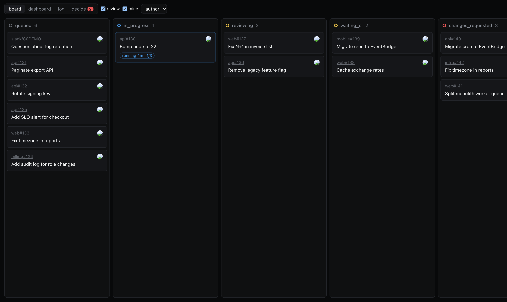
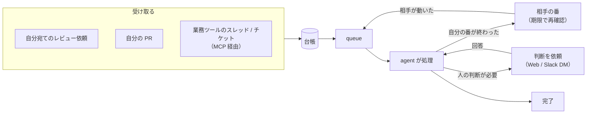
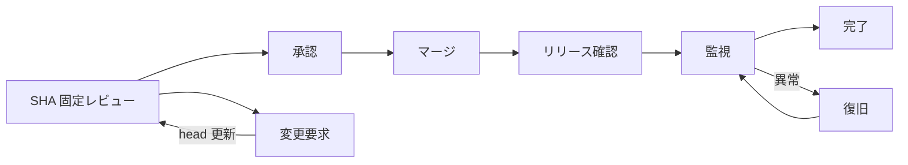
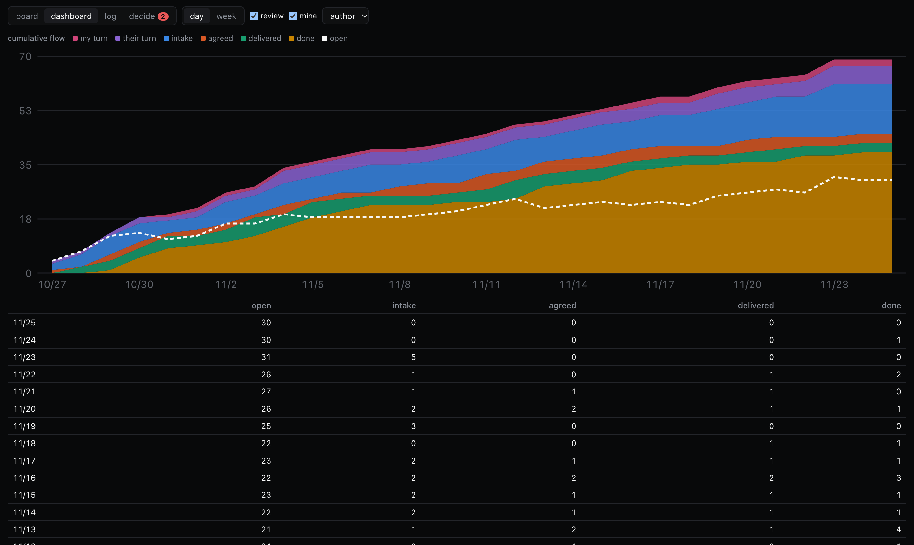
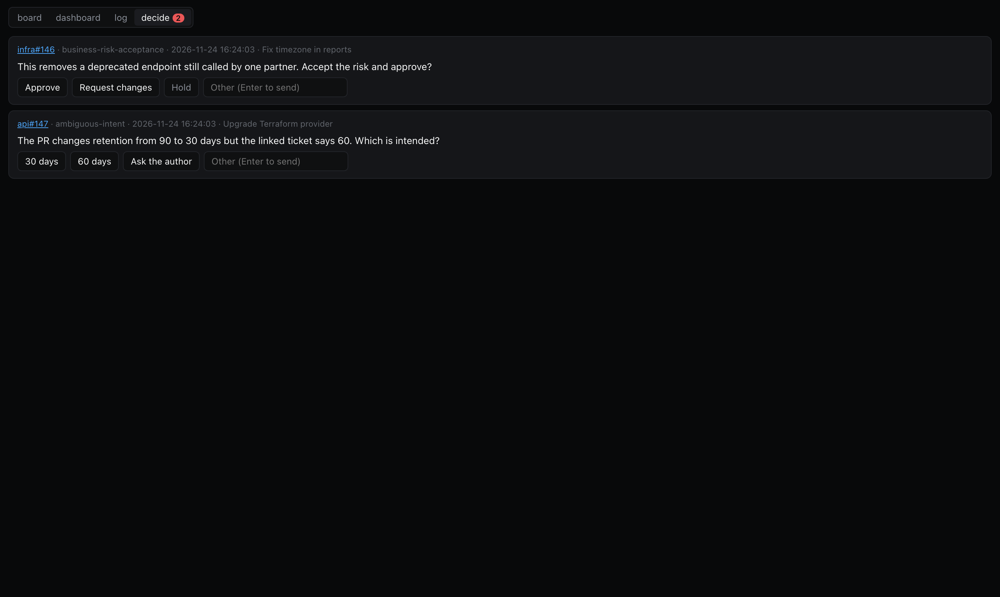

# Ledger-driven review workspace

自分宛てのレビュー依頼、自分の PR、業務ツール（Slack、Jira など）のスレッドやチケットを 1 つの台帳で受け、agent が「自分の番」のものを片付け続けるワークスペースです。人に残すのは、ポリシー上 agent が決めてはいけない判断だけです。

PR の完了条件は承認やマージではありません。レビュー時に決めたリリース計画どおりにデプロイされ、監視時間を通して健全だったことを証跡として残した時点で完了です。



## 考え方

- **台帳が唯一の操作範囲**: agent が触れるのは台帳に載った PR・スレッド・チケットだけです。候補を推測して広げません。
- **ball を持っている側が動く**: どの項目も「自分の番」「相手の番」「人の判断待ち」「完了」のいずれかです。自分の番のものだけを agent が処理し、相手の番にはフォローアップの期限を持たせます。
- **SHA を固定して判断する**: レビューは特定の base/head に対する判断です。head、CI、レビュースレッドが変われば以前の判断は無効になり、最初からやり直します。
- **不明は安全の根拠にしない**: 確認できない状態では承認しません。
- **人には判断だけを渡す**: 業務リスクの受容や意図が曖昧なときなど、決められた理由のときだけ人に聞きます。答えは過去の判断として蓄積され、次の判断に使われます。

## 全体フロー



レビュー依頼の PR は次の段階を進みます。



## 画面

`serve` が `http://127.0.0.1:8765/` で参照用の画面を出します（loopback のみ）。

| dashboard | decide |
|---|---|
|  |  |

- **board**: 台帳の各項目を状態ごとに並べます。
- **dashboard**: 受け取り・合意・リリース・完了の累積フローです。
- **log**: 各プロセスのログを時間範囲・レベル・項目で絞り込みます。
- **decide**: 人の判断待ちに回答します。同じ質問は Slack の DM にも届き、スレッドへの返信でも回答できます。

スクリーンショットはデモデータです（`bun app/src/demo.ts`）。

## 業務ツールをつなぐ

業務ツールは MCP サーバー経由で扱い、ツールごとの接続定義を `skills/sources/<name>/SOURCE.md` に置きます。定義には、URL から項目を識別する規則と、worker がそのツールで依頼を集めて返信する手順を書きます。Slack と Jira が同梱されていて、ディレクトリを足せば別のツールも同じ台帳・queue・判断の流れに乗ります。

## セットアップ

端末・組織固有の値は gitignore 済みの `config/` に置きます。

```sh
cp config/config.example.toml config/config.toml
(cd app && bun install --frozen-lockfile)
scripts/install-launchd.sh
```

launchd が依頼の同期、業務ツールの同期、判断の DM、`serve`（queue と画面）を定期実行します。`config.toml` で稼働時間帯を指定できます。

## 詳細

- [レビュー運用手順](skills/review-ledger-prs/SKILL.md)
- [承認・dispatch ポリシー](skills/review-ledger-prs/references/policy.md)
- [delivery lifecycle](skills/review-ledger-prs/references/delivery-lifecycle.md)
- [exact-URL intake](skills/add-review-ledger-prs/SKILL.md)
- [業務ツールの同期](skills/sync-tasks/SKILL.md) と [対応](skills/respond-tasks/SKILL.md)
- [判断の Slack DM](skills/decide-dm/SKILL.md)
