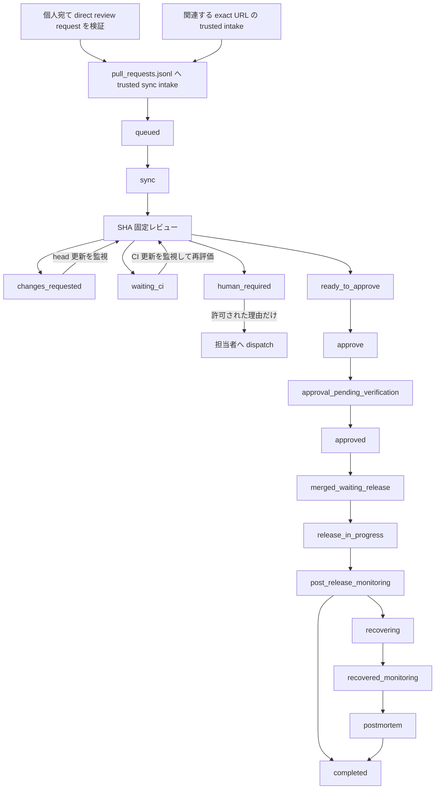

# Ledger-driven PR review workspace

`pull_requests.jsonl` に正確な URL で登録された <org> の Pull Request だけを対象に、レビュー、承認、マージ後のリリース確認、監視、復旧までを管理するワークスペースです。

このワークスペースの完了条件は PR の承認やマージではありません。レビュー時に定めたリリース計画に従い、対象リビジョンのデプロイと所定時間の健全性を確認し、必要な証跡を台帳へ記録した時点で完了します。

## セットアップ

端末・組織固有の値はすべて gitignore 済みの `config/` 配下で管理します。

```sh
cp config/config.example.toml config/config.toml          # org, GHTKN app, launchd label, 通知先, worker コマンド, team scope
(cd app && bun install --frozen-lockfile)
scripts/install-launchd.sh
```

`REVIEW_ORG` 環境変数は `config.toml` の `org` より優先されます。

## 重要な制約

- `pull_requests.jsonl` が唯一の操作範囲です。台帳にない PR をレビュー、承認、変更要求、dispatch、マージ、リリース操作してはいけません。
- 台帳へ追加できるのは、GitHub の live `reviewRequests` で認証中の
  login に直接 `User` request があると確認した open PR、
  `config/config.toml` の `[[scopes]]`（team の作者・リポジトリ）に一致すると
  `app/src/review-poller.ts` が確認した open PR、または現在の作業
  文脈・掲載済み PR の live 証跡に現れた完全な
  `https://github.com/<org>/<repo>/pull/<number>` URL だけです。正確な URL の
  追加に個別のユーザー確認は不要です。scope 定義の外で、team/CODEOWNERS、
  作者、ラベル、リポジトリ名などから候補集合を推測・拡張しません。
- launchd の `review-request-sync`（direct request）と `review-team-poller`（scope）が 10 分ごとに intake します。worker の起動は `serve` の queue（`app/src/queue.ts`）だけが行い、poller は起動しません。
- queue は 15 秒ごとに、`queued` の scope 行・direct request 行と、承認後検証が `pending` の行を対象にします。draft の PR は対象外で、実行も失敗計上もしません。同時実行は 50 までです。worker 終了後も行が対象のままなら失敗として 10 分後に再実行し、同じ head で 3 回失敗すると `exhausted` になり、新しい head まで止めます。状態は `logs/queue.json` に保存します。
- ready の PR が draft に戻った場合、`sync` は `DRAFTED` を出し、判定と証跡をリセットして `queued` に戻し、既存の承認は再検証待ち（`pending`）にします。ready に戻ると queue が再レビューします。
- このワークスペースはレビュー専用です。リモートへの commit、branch、tag の push は禁止で、review PR の head branch への通常 push、amend、force-push も行いません。検証済みの復旧で forward-fix が必要な場合は、個別確認なしで別の実装 checkout から新規 branch・別 PR として、signed commit と通常の non-force push で公開できます。
- リポジトリの内容は `repositories/<owner>/<repo>` のローカル checkout から読みます。存在しない場合は通常の Git tooling で取得し、コンテンツ取得に `gh api` は使いません。
- base SHA、head SHA、PR の更新、CI、レビュー thread のいずれかが変わると、以前のレビュー証跡は無効です。新しい状態を再レビューします。
- 不明な状態は安全の根拠にせず、approval gate を閉じます。

## 全体フロー



監視コマンドは状態変化を検知するだけです。レビュー、判定、リリース確認、復旧の gate を代行したり省略したりしません。

## 1. 個人宛て review request を同期する

`review-requested:@me` は team/CODEOWNERS 由来の依頼も含みます。
`$review-ledger-prs` は処理開始時に次の sync を必ず実行します。GraphQL で
候補と `reviewRequests` を100件ずつ同時取得し、認証中の GitHub login と
一致する `User` request がある open PR だけを `pull_requests.jsonl` へ
追加します。自分の最新レビューが push で DISMISSED になった open PR も
`dismissed-own-review` として追加し、再レビュー対象にします。

```bash
GHTKN_APP=<org>/read bun app/src/review-requests.ts sync
GHTKN_APP=<org>/read bun app/src/review-requests.ts list
```

`pull_requests.jsonl` が direct-request 状態とレビュー操作範囲を保持する唯一の台帳です。新規 direct request は優先度 `50` で `queued` に追加されます。GitHub 上で request が解除されても操作範囲の行は削除せず、`review_request.active` を `false` にして履歴を残します。GraphQL search の1,000件上限を超える範囲は作成日で再帰分割します。ページ取得、direct-request metadata、または新規行の live validation に失敗した場合、direct-request 行を一件も追加せず sync は失敗します。team/CODEOWNERS 由来の候補は追加・件数集計しません。

ledger内の承認済みPRに新しいcommitが追加された場合、同じ `sync` が `HEAD_CHANGED` を出力し、古い証跡と判定を無効化して対象を `queued` に戻します。`reviewctl next` で再レビュー対象として取得できます。

同じ CLI から trusted exact-URL intake も呼び出せます。`add` は direct
request がない関連 PR を追加する補助経路で、現在の作業文脈または掲載済み
PR の live 証跡にある完全な PR URL だけを受け付けます。

```bash
GHTKN_APP=<org>/read bun app/src/review-requests.ts add \
  https://github.com/<org>/<repo>/pull/<number> \
  --priority 50 \
  --reason "掲載済み PR の失敗ログに生成先として記録された復旧 PR"

GHTKN_APP=<org>/read bun app/src/review-requests.ts add \
  https://github.com/<org>/<repo>/pull/<number> \
  --priority 50 \
  --reason "掲載済み PR の失敗ログに生成先として記録された復旧 PR" \
  --execute
```

## 2. PR を台帳へ追加する

台帳追加とレビュー実行は分離されています。intake は GitHub への書き込みや PR のレビューを行わず、追加に個別のユーザー確認は不要です。

最初に現在の台帳を検証します。

```bash
bun app/src/intakectl.ts validate
```

完全な PR URL、優先度、追加理由を指定して dry-run します。優先度は `0` から `100` で、小さい値から処理されます。省略時は `50` です。

```bash
bun app/src/intakectl.ts add \
  https://github.com/<org>/<repo>/pull/<number> \
  --priority 50 \
  --reason "exact URL の出所と現在の作業との関係"
```

出力、対象 URL、base/head SHA を確認し、同じ入力へ `--execute` を付けて追加します。複数 URL は全件の live validation が成功した場合だけ一括で追加されます。既存 URL は変更されません。

```bash
bun app/src/intakectl.ts add \
  https://github.com/<org>/<repo>/pull/<number> \
  --priority 50 \
  --reason "exact URL の出所と現在の作業との関係" \
  --execute
```

最後に `validate` を再実行します。既存行の URL、対象リポジトリ、PR 番号、優先度、操作範囲を手作業で編集・削除・変更してはいけません。

## 3. レビュー対象を同期する

```bash
bun app/src/reviewctl/cli.ts validate
bun app/src/reviewctl/cli.ts sync
bun app/src/reviewctl/cli.ts next
```

- `validate`: JSONL のスキーマ、URL と repository/PR 番号の整合、重複などを検証します。
- `sync [URL]`: GitHub の live state、base/head SHA、draft、mergeability、CI、review decision を同期し、状態遷移イベントを出力します。
- `next [--limit N]`: 優先度と追加時刻に従い、次に処理すべき PR を返します。
- `list [--status STATUS]`: 台帳行を参照します。

## 4. SHA を固定してレビューする

対象リポジトリをローカルに用意し、Git の worktree で checkout を分離します。必ず live の `baseRefOid...headRefOid` と一致する diff を確認します。

レビューでは少なくとも次を確認します。

- リポジトリ固有の指示、変更差分、影響する caller
- 既存テストと変更に比例したテスト・lint
- セキュリティ影響
- 必須 CI
- PR の `updatedAt` 取得後に確認した unresolved review thread が 0 件であること
- 実際のリリース経路、SIEMで確認できる監視シグナル、30分以上の監視時間、可逆な復旧手順

レビュー結果は PR ごとに `review-artifacts/<owner>--<repo>--<number>.json` へ保存します。形式は [`artifact-schema.md`](skills/review-ledger-prs/references/artifact-schema.md) を参照してください。

```bash
bun app/src/reviewctl/cli.ts record \
  <PR_URL> review-artifacts/<owner>--<repo>--<number>.json
bun app/src/reviewctl/cli.ts gate <PR_URL>
```

`record` は証跡の SHA-256 を台帳へ記録します。記録後にファイルが変わると gate は失敗します。

## 5. 判定を反映する

### 承認

`gate` が通った直後に、exact head commit に対して guarded approval を実行します。

```bash
bun app/src/reviewctl/cli.ts approve \
  <PR_URL> --execute
```

書き込み直後に新しい `updatedAt` を取得し、承認時刻より後の review thread と live state を再確認します。同じ証跡の時刻・thread 情報だけを更新して `record` を再実行します。base/head SHA と凍結済み delivery plan が同じ場合にだけ `approved` になります。

### 変更要求

具体的な修正内容を Markdown に保存して送ります。

```bash
bun app/src/reviewctl/cli.ts request-changes \
  <PR_URL> review-artifacts/<owner>--<repo>--<number>-changes.md \
  --execute
```

その後も agent が head 更新を監視し、更新された SHA を最初から再レビューします。

### human dispatch

人へ dispatch できるのは、ポリシーで定めた次の理由だけです。

- `required-human-identity`
- `business-risk-acceptance`
- `unavailable-evidence`
- `ambiguous-intent`
- `incident-coordination`

コード不具合、脆弱性、失敗・実行中の CI、レビューコメント、巨大な差分、低い確信度、修正可能な conflict は agent が処理します。

```bash
bun app/src/reviewctl/cli.ts dispatch \
  <PR_URL> --reviewer <LOGIN> --execute
```

## 6. マージ後の delivery を完了させる

`sync` がマージを検出すると `merged_waiting_release` へ進みます。レビュー時に凍結した delivery plan を読み、実際のリリースを確認します。

```bash
bun app/src/deliveryctl.ts due
```

release、observation、incident、recovery、postmortem の各証跡を `delivery-artifacts/` に保存し、その都度記録します。

```bash
bun app/src/deliveryctl.ts record \
  <PR_URL> delivery-artifacts/<receipt>.json
```

正常系では次をすべて確認します。

1. release の開始と成功が同じ release ID、attempt、workflow、environment、commit に結び付くこと
2. デプロイ済み commit がレビュー対象の merge SHA を含むこと
3. SIEMログだけを使い、連続30分以上かつ計画時間以上の区間を分析して、計画した全シグナルに問題がないこと

外形アクセス、production UI、Datadog直接query、production infrastructureの状態はリリース監視の証跡に使いません。異常時はSIEMの根拠とともにincidentを記録し、計画済みの rollback、feature flag、hotfix、compatibility 対応、redeploy などの可逆な復旧を agent が実施します。forward-fix は review PR の branch を変更せず、別 branch・別 PR として公開します。復旧後もSIEMだけで監視時間を最初から満たし、postmortemを記録します。

必要な証跡が揃ったら completion gate を実行します。

```bash
bun app/src/deliveryctl.ts complete <PR_URL>
```

receipt の詳細は [`delivery-lifecycle.md`](skills/review-ledger-prs/references/delivery-lifecycle.md) を参照してください。

## 7. 継続監視する

定期実行では各 tick につき一度ずつ実行します。

```bash
bun app/src/reviewctl/cli.ts monitor --once
bun app/src/deliveryctl.ts due
```

`BASE_CHANGED`、`HEAD_CHANGED`、`DRAFTED`、`PR_UPDATED`、`CI_PENDING`、`CI_FAILED`、`CHANGES_REQUESTED`、`APPROVAL_CANDIDATE`、`MERGED`、`CLOSED`、`SYNC_FAILED` など、出力されたイベントは同じ tick で処理します。`serve` が起動中の場合、`monitor --once` は二重に実行しないでください。

```bash
cd app && bun install && bun run start
```

`serve`（`app/`、Bun / TypeScript）は `--interval` 秒ごとに `monitor --once` を実行し、別ループで worker queue を回し、`http://127.0.0.1:8765/` で台帳の board（queue の実行中は `in_progress` 列）、dashboard、log（`#log`、時間範囲・レベル・source で絞り込み、JST 表示）を返します。bind 先は loopback のみで、参照専用です。launchd では `launchd/reviewctl-serve.plist.in` を `sh scripts/install-launchd.sh` で checkout のパスに展開して登録します。検証は `cd app && bun test && bun run typecheck` で行います。

## ディレクトリ構成

```text
pull_requests.jsonl
  操作対象と現在状態を保持する唯一の台帳

app/src/review-requests.ts
  個人宛て direct review request の trusted sync intake と exact URL intake の入口

review-artifacts/
  SHA 固定レビューの JSON 証跡と変更要求本文

delivery-artifacts/
  release、監視、incident、復旧、postmortem の証跡

worktrees/
  PR ごとの分離されたレビュー用 checkout

repositories/
  対象リポジトリのローカル checkout

skills/add-review-ledger-prs/
  exact URL だけを台帳へ追加する intake

skills/review-ledger-prs/
  レビュー、approval gate、監視、delivery lifecycle
```

## 詳細仕様

- [レビュー運用手順](skills/review-ledger-prs/SKILL.md)
- [承認・dispatch ポリシー](skills/review-ledger-prs/references/policy.md)
- [台帳スキーマ](skills/review-ledger-prs/references/ledger-schema.md)
- [レビュー証跡スキーマ](skills/review-ledger-prs/references/artifact-schema.md)
- [delivery lifecycle](skills/review-ledger-prs/references/delivery-lifecycle.md)
- [exact-URL intake 手順](skills/add-review-ledger-prs/SKILL.md)
- [exact-URL intake ポリシー](skills/add-review-ledger-prs/references/manual-intake-policy.md)

オーケストレーションスクリプト専用のテストコードは作りません。検証は実際の台帳に対する `validate`、`sync`、`monitor --once`、`due` と、台帳掲載 PR に対する実フローで行います。
